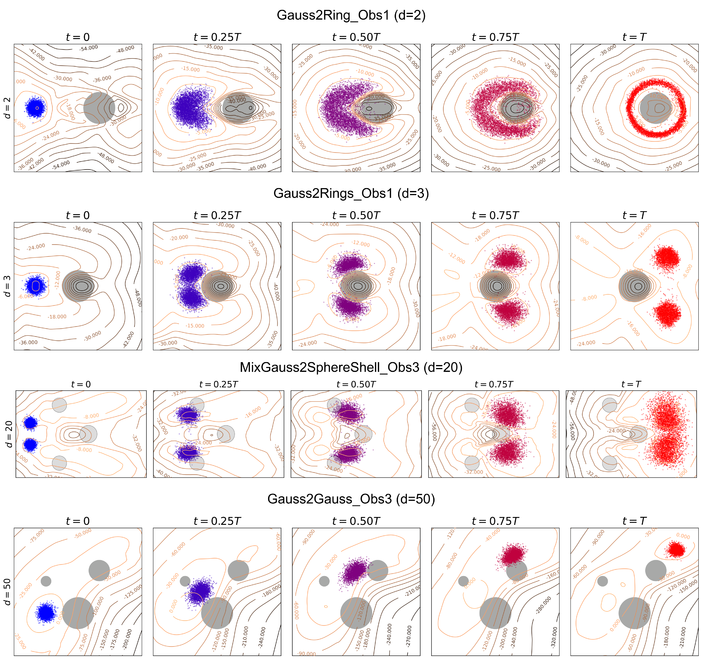
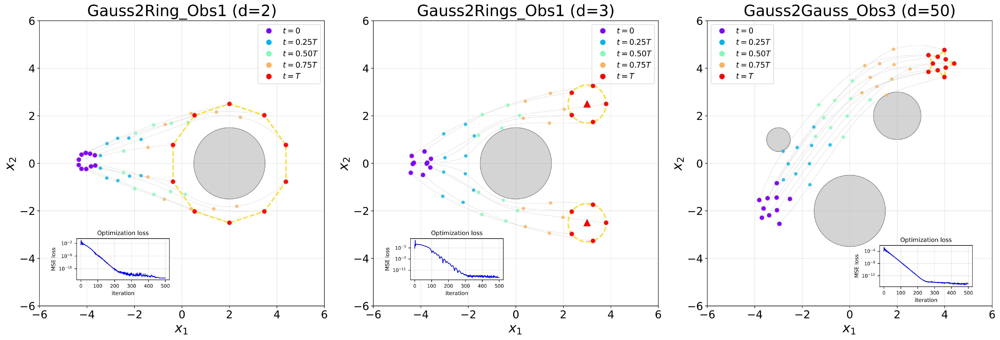
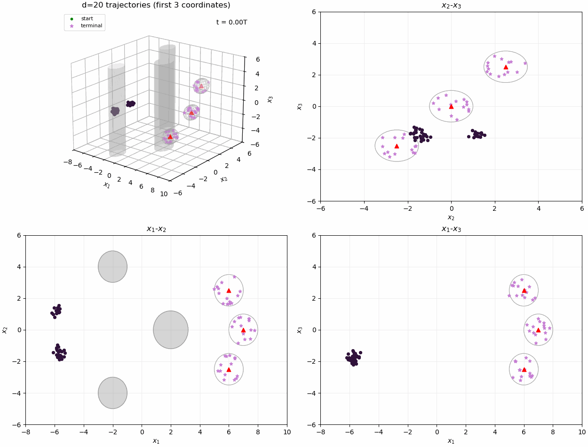
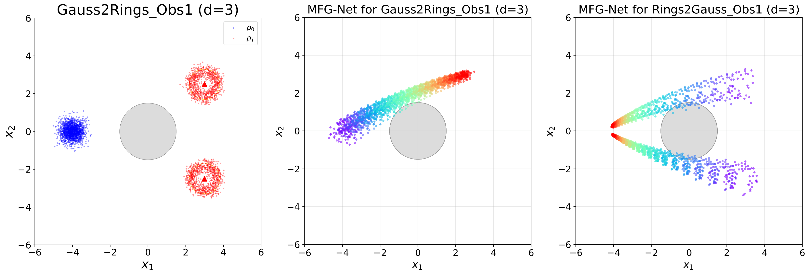
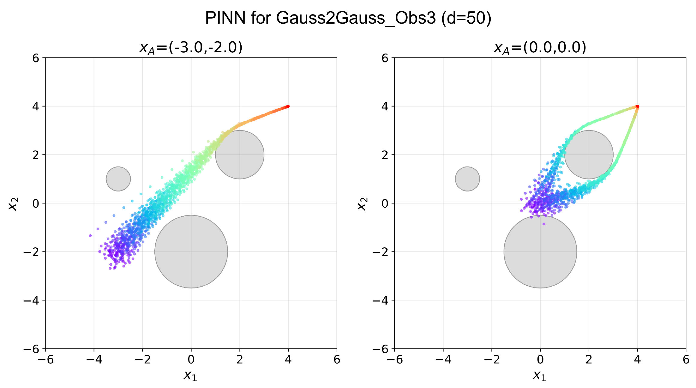
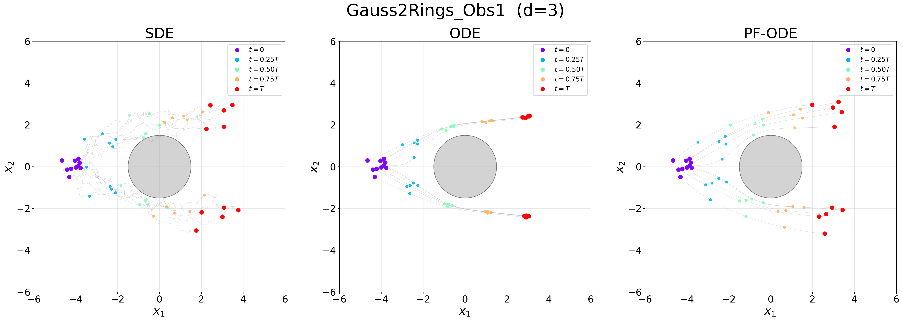
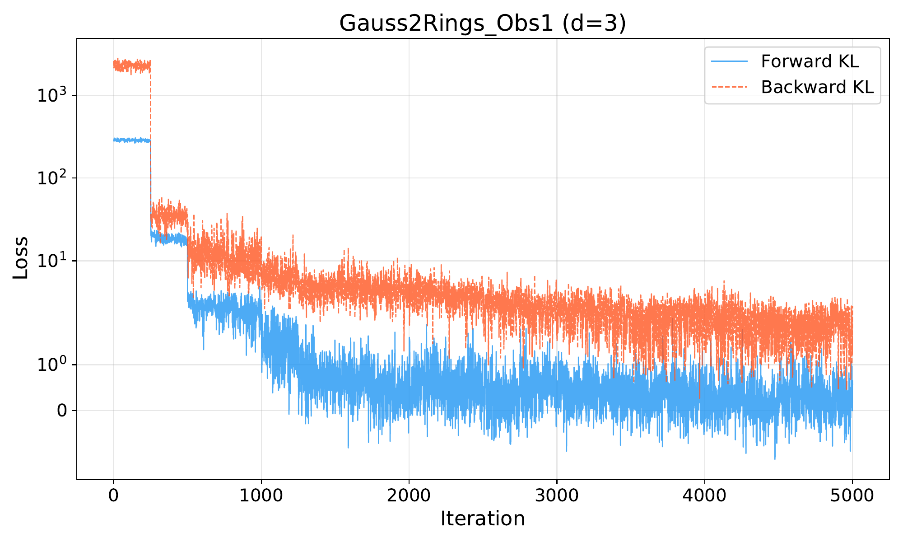
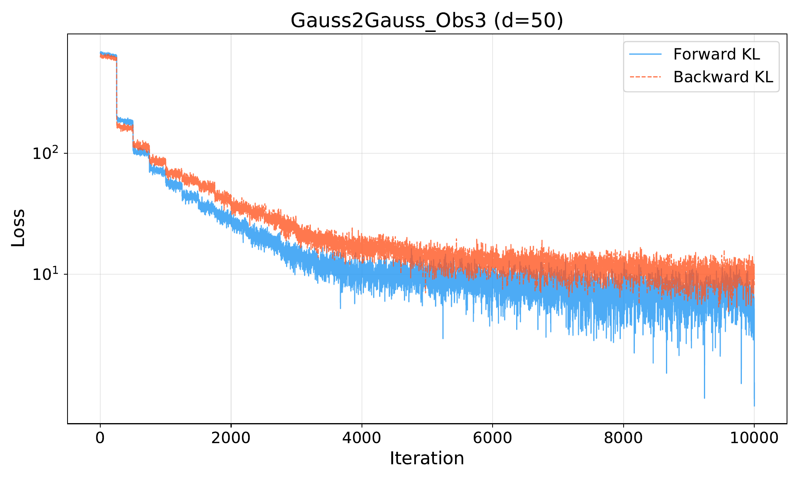
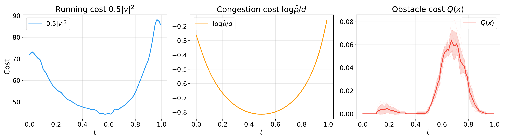

<div align="center">

# DeepGSB for Multi-Agent Formation and Task Allocation

**ACML 2026 · Journal Track · Paper ID 2026-2450**

Feng Liu, Faguo Wu\*, Xiao Zhang\*

Beihang University

[](https://www.acml-conf.org/2026/program/)
[](main.pdf)
[](code/)

📄 [Paper (PDF)](main.pdf) · 📎 [Appendix](Appendix.pdf) · 💻 [Code](code/) · 🖼 [Figures](figures/)

</div>

---

## Overview

Cooperative control of multi-agent systems lies at the intersection of artificial intelligence
and control theory, with applications in UAV swarms, robot formations, and crowd simulation.
Its core mathematical model is the **coupled Hamilton–Jacobi–Bellman (HJB) and Fokker–Planck (FP)
system** of **mean-field games (MFGs)**: the backward HJB equation describes each agent's optimal
action, while the forward FP equation governs the evolution of the population density. The two are
bidirectionally coupled, which is the central difficulty of the problem.

This paper builds **four challenging high-dimensional MFG benchmarks** with complex, multi-modal
terminal distributions and obstacles, and systematically compares the three families of solvers:

| Family | Representative | Core idea |
|---|---|---|
| PDE-based | **PINN** | Minimize coupled HJB–FP residuals at collocation points |
| Optimization-based | **MFG-Net** | Parameterize the value function and minimize the total cost along ODE trajectories |
| Probabilistic | **DeepGSB** | Solve the MFG through forward–backward SDEs with a Schrödinger-bridge structure |

We show *why* PINN and MFG-Net fail on these problems, and why DeepGSB's forward–backward
constraint structure is numerically better behaved. To turn the learned mean-field solution into
practical swarm control, we propose a **Probability Flow ODE (PF-ODE)** controller that yields
smooth, deterministic, collision-free trajectories for every agent — enabling **collision
avoidance, obstacle avoidance, formation control, and multi-target task allocation** in 2–50
dimensions.

<p align="center">
  
</p>

<p align="center"><em>
Swarm evolution controlled by the PF-ODE of DeepGSB on four MFG benchmarks.
Top to bottom: Gauss2Ring_Obs1 (d=2), Gauss2Rings_Obs1 (d=3),
MixGauss2SphereShell_Obs3 (d=20), Gauss2Gauss_Obs3 (d=50). Color encodes time;
gray disks are obstacles.
</em></p>

---

## Key Contributions

1. **Four challenging MFG benchmarks.** We construct Gauss2Ring_Obs1, Gauss2Rings_Obs1,
   MixGauss2SphereShell_Obs3, and Gauss2Gauss_Obs3 with multi-modal targets and obstacles,
   covering ring/sphere-shell formations and many-to-many task allocation in 2–50 dimensions.

2. **A diagnosis of why PINN fails on coupled HJB–FP systems.** We identify three fundamental
   difficulties: (i) **PDE residual failure** — poorly initialized $(\phi,\rho)$ makes the residual
   loss unable to guide training; (ii) **magnitude imbalance** — the density decays exponentially in
   high dimensions, so the HJB and FP losses differ by orders of magnitude; (iii) **log-likelihood
   noise amplification** — rewriting FP in $\log\rho$ balances the scales but amplifies noise in
   low-density regions.

3. **A characterization of MFG-Net's representational limit.** The characteristic ODE is a
   continuous, topologically homeomorphic map, so it cannot represent certain transports (e.g. a
   unimodal Gaussian to two separated rings); unidirectional training reinforces this, trapping the
   model in a **single mode** and making multi-target allocation impossible — even after swapping
   initial and terminal distributions to exploit reversibility.

4. **A principled explanation of DeepGSB's advantage.** The Hopf–Cole transform removes the
   nonlinear $\|\nabla\phi\|^2$ term, and the FBSDE formulation learns both drift terms
   $v_f=\sigma Z_t$ and $v_b=\sigma\widehat{Z}_s$ under known boundary distributions. This yields
   well-scaled optimization objectives, off-policy data reuse, and **bidirectional training** that
   captures multi-modal $\rho_T$ and supports task allocation — properties neither PINN nor
   MFG-Net possesses.

5. **PF-ODE for smooth multi-agent control.** The forward SDE is noisy and the naive
   optimal-control ODE causes congestion and collisions. We propose the probability flow ODE
   $$v_p=\frac{1}{2}(v_f-v_b)=v^*-\frac{1}{2}\sigma^2\nabla\log\rho,$$
   fine-tune the initial positions to hit prescribed terminal targets, and obtain deterministic,
   continuous, reversible trajectories for formation transformation and task allocation.

---

## Method at a Glance

```
coupled HJB–FP system  ──Hopf–Cole──▶  (Ψ, Ψ̂) PDEs  ──Feynman–Kac──▶  FBSDEs
                                                                        │
                        ┌───────────────────────────────────────────────┘
                        ▼
        forward drift  v_f = σ Z_θ          backward drift  v_b = σ Ẑ_α
                        └──────────────┬──────────────┘
                                       ▼
                     PF-ODE  ẋ = ½ (v_f − v_b)   ──▶  deterministic swarm trajectories
```

- **Losses** for the backward process: boundary label loss $\mathcal{L}_{\text{init}}$,
  KL divergence $\mathcal{L}_{\text{KL}}$, temporal-difference loss $\mathcal{L}_{\text{TD}}$
  (single- or multi-step), and a gradient-consistency loss $\mathcal{L}_{\text{grad}}$.
- Forward and backward networks are trained **alternately with crossed sampling**, reusing
  trajectories off-policy instead of re-simulating at every iteration.
- The PF-ODE is simulated per agent and its initial states are optimized so that terminal
  positions match the assigned targets (Eq. (correction) in the paper).

---

## Results

### Formations and trajectory planning

<p align="center">
  
</p>

<p align="center"><em>
Deterministic trajectories generated by the PF-ODE. Star-shaped, circular, and encirclement
formations emerge from the transport between $\rho_0$ and $\rho_T$; agents avoid obstacles and
maintain separation.
</em></p>

### Many-to-many task allocation (d = 20)

<p align="center">
  
</p>

<p align="center"><em>
PF-ODE transports a bimodal Gaussian initial population onto three sphere-shell targets while
avoiding three cylindrical obstacles — many-to-many assignment with full target coverage.
(<a href="figures/MixGauss2SphereShell_Obs3_d20_trajectory.png">static figure</a>)
</em></p>

### Why PINN and MFG-Net fall short

<table>
<tr>
<td width="50%">

<p align="center"><em>
<b>MFG-Net.</b> On Gauss2Rings it covers only one target; on the reversed Rings2Gauss problem the
two branches never merge into a Gaussian. The continuous ODE cannot perform the required split.
</em></p>
</td>
<td width="50%">

<p align="center"><em>
<b>PINN.</b> A global value function plans a path for a single agent from any start, but ignores
interaction costs, so a swarm overlaps and collides.
</em></p>
</td>
</tr>
</table>

### SDE vs. optimal-control ODE vs. PF-ODE

<p align="center">
  
</p>

<p align="center"><em>
The forward SDE is noisy; the optimal-control ODE makes agents cluster and collide; the PF-ODE
produces smooth, separated, continuous trajectories suitable for real swarm control.
</em></p>

### Quantitative comparison (Gauss2Gauss_Obs3, N = 500 agents, mean ± std over 5 runs)

Lower is better for every cost. Best value per column in **bold**.

| Method | d | C<sub>total</sub> | C<sub>run</sub> | C<sub>cong</sub> | C<sub>obs</sub> | C<sub>term</sub> |
|---|---:|---:|---:|---:|---:|---:|
| PINN | 20 | 3.3289 ± 0.0023 | 2.7585 ± 0.0073 | 0.0703 ± 0.0003 | **0.0000** ± 0.0000 | 0.5000 ± 0.0000 |
| PINN | 50 | 3.4121 ± 0.0133 | 2.7149 ± 0.0037 | 0.0524 ± 0.0002 | 0.1445 ± 0.0113 | 0.5002 ± 0.0000 |
| MFG-Net | 20 | **2.3553** ± 0.0033 | **2.2887** ± 0.0039 | −0.0011 ± 0.0005 | 0.0174 ± 0.0022 | 0.0503 ± 0.0017 |
| MFG-Net | 50 | **2.3605** ± 0.0081 | **2.3211** ± 0.0024 | −0.0016 ± 0.0001 | **0.0172** ± 0.0062 | **0.0239** ± 0.0003 |
| DeepGSB | 20 | 2.6231 ± 0.0089 | 2.5709 ± 0.0063 | **−0.0326** ± 0.0004 | 0.0636 ± 0.0040 | **0.0211** ± 0.0014 |
| DeepGSB | 50 | 2.9825 ± 0.0128 | 2.8285 ± 0.0022 | **−0.0324** ± 0.0001 | 0.1388 ± 0.0144 | 0.0476 ± 0.0020 |

**Reading the table.** DeepGSB attains the **lowest congestion cost** at both dimensions and the
**lowest terminal cost at d = 20** — the two terms that matter for formation quality and safety.
MFG-Net has a lower total cost on this *single-target* problem, but it cannot cover multi-modal
targets at all; its advantage does not transfer to task allocation. PINN drives the obstacle cost
to zero at d = 20 only by collapsing the swarm onto overlapping paths, as its high congestion cost
shows.

### Training behavior

<p align="center">
  
  
</p>
<p align="center"><em>DeepGSB training losses on a low- and a high-dimensional benchmark.</em></p>

<p align="center">
  
</p>
<p align="center"><em>
Evaluation costs along the controlled trajectory at d = 50: running, congestion, and obstacle
costs all stay low and balanced over the whole horizon.
</em></p>

---

## Conclusions

- PINN's failure on coupled HJB–FP systems is structural, not a tuning issue: residual failure and
  magnitude imbalance persist across initializations and loss rescalings.
- MFG-Net's continuity constraint is a representational ceiling: it cannot split mass from a
  unimodal source to multi-modal targets, so single-mode collapse is unavoidable on these tasks.
- DeepGSB's FBSDE drift terms provide well-scaled, distribution-guided supervision, and its
  bidirectional training solves multi-modal benchmarks that the baselines cannot.
- The PF-ODE converts the learned bridge into smooth, deterministic, reversible swarm control,
  demonstrated on collision avoidance, obstacle avoidance, formation transformation, and
  multi-target task allocation from 2 to 50 dimensions.

**Future work.** Dynamic target encirclement, personalized policies for heterogeneous agents, and
integration with real-time planning systems.

---

## Code

```
code/
├── DeepGSB/       # proposed method: training, evaluation, PF-ODE trajectory plotting
├── MFG-Net/       # optimization-based baseline
├── PINN/          # PDE-based baseline (HJB solver)
└── new_metrics/   # rollout, metric computation, and reporting utilities
```

**Requirements.** Python 3.8+, PyTorch, `geomloss`, `torch_ema`, `easydict`, NumPy, Matplotlib.
A CUDA GPU is recommended (experiments in the paper used an NVIDIA Tesla T4, 16 GB).

**Run one experiment**

```bash
cd code/DeepGSB
python main_deepgsb.py \
    --problem-name Gauss2Gauss_Obs3 \
    --x-dim-override 20 \
    --device cuda:0 \
    --seed 42
```

**Reproduce the full benchmark suite**

```bash
cd code/DeepGSB
bash run_experiments.sh          # all four problems, all dimensions
```

Baselines follow the same pattern:

```bash
cd code/MFG-Net && bash run_experiments.sh
cd code/PINN    && bash run_experiments.sh
```

Trained models, logs, and trajectory figures are written to
`code/DeepGSB/Experiments/<problem>_d<dim>_<timestamp>/`. To regenerate trajectory figures after
training:

```bash
cd code/DeepGSB
python plot_trajectory.py \
    --model-dir Experiments/Gauss2Gauss_Obs3_d20_<timestamp> \
    --mode pf-ode --n-particles 10 --device cpu
```

Use `python plot_trajectory.py --help` for the comparison, formation, and formation-control modes.

---

## Paper

- **Title:** DeepGSB for Multi-Agent Formation and Task Allocation
- **Venue:** ACML 2026, Journal Track
- **Paper ID:** 2026-2450
- **PDF:** [`main.pdf`](main.pdf) · **Appendix:** [`Appendix.pdf`](Appendix.pdf)

### ACML 2026 Presentation

| | |
|---|---|
| **Poster** | Thu 2:30–4:00 PM · **Poster 5** |
| **Oral** | Thu 4:30–6:00 PM · **Oral 5C**, Room 3 |
| **Session** | Structured Reasoning and Multi-Agent Systems |
| **Program** | <https://www.acml-conf.org/2026/program/> |

### Citation

```bibtex
@inproceedings{liu2026deepgsb,
  title     = {DeepGSB for Multi-Agent Formation and Task Allocation},
  author    = {Liu, Feng and Wu, Faguo and Zhang, Xiao},
  booktitle = {Proceedings of the Asian Conference on Machine Learning (ACML)},
  year      = {2026},
  note      = {Journal Track, Paper ID 2026-2450}
}
```

---

## Contact

Feng Liu — Liu_Feng@buaa.edu.cn
Faguo Wu (corresponding) — faguo@buaa.edu.cn
Xiao Zhang (corresponding) — xiao.zh@buaa.edu.cn

School of Artificial Intelligence, Beihang University, Beijing, China.

## Acknowledgements

This work was supported by the National Natural Science Foundation of China (12441101), the
Fundamental Research Funds for the Central Universities, and the Beijing Advanced Innovation
Center for Future Blockchain and Privacy Computing.
